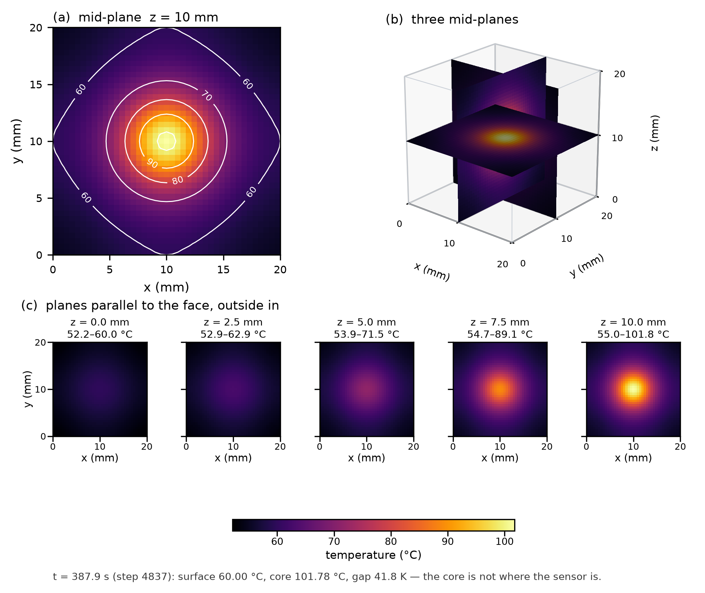
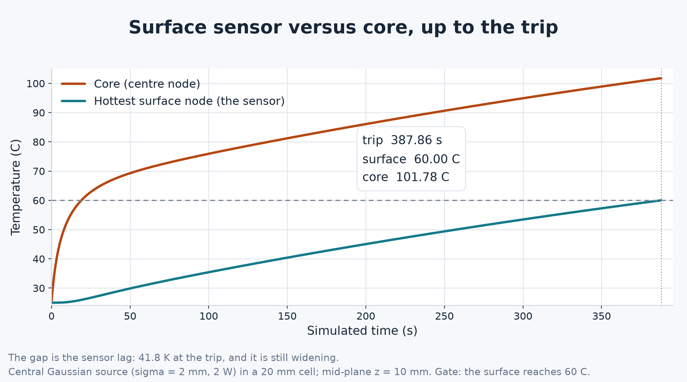
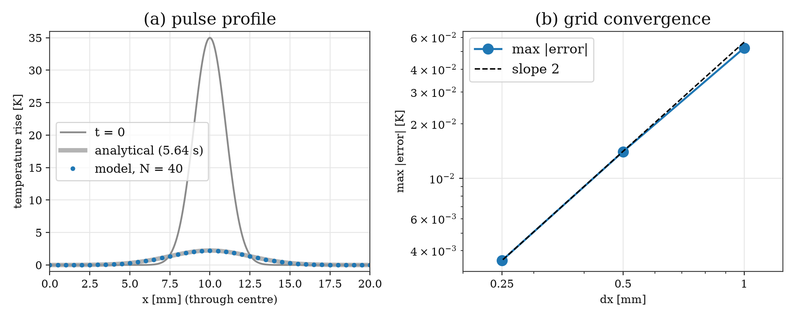

# Battery Management System

Battery Management System team project (EE3180).

This repository holds the thermal model used in the project and everything
needed to reproduce its results: a three-dimensional finite-difference model
of a single lithium-ion cell, the same model written in C, and the measurement
of how fast that C program runs on four low-cost single-board computers.

The question behind it: a BMS can only measure temperature at the cell
surface, but heat is generated inside the cell. A lumped model cannot say
where the hot spot is, so the BMS has to use conservative limits. This project
asks whether a spatially resolved model is cheap enough to run on the small
processors an onboard computer actually has.

## The model

```
rho*Cp dT/dt = k * Laplacian(T) + q'''(r)
q'''(r)       = A exp(-r^2 / (2 sigma^2)),   sum(q''' * W) = Q_total
-k dT/dn      = h (T - T_amb)                on all six faces
```

| Parameter | Value |
| --- | --- |
| Cell | 20 x 20 x 20 mm cube |
| Grid | 41 x 41 x 41 = 68,921 nodes, dx = 0.5 mm |
| k / rho / Cp | 1.04 W/(m K) / 1555 kg/m^3 / 1437 J/(kg K) |
| Q_total | 2 W, Gaussian source, sigma = 2 mm |
| h / T_amb | 10 W/(m^2 K) / 25 degC |
| Time step | 0.08019 s (0.90 x the stability limit) |
| Stop | hottest surface node reaches 60 degC |

The solver is a vertex-centred finite volume scheme on the explicit (FTCS)
stencil: a node owns a whole cell in the interior, half a cell on a face, a
quarter on an edge and an eighth at a corner, and convects through every face
it exposes. It conserves energy to round-off and is second order in space.

## The result



At the moment the surface sensor trips, the centre of the cell is **41.8 K
hotter** than the face that carries the sensor. The cut-away and the
depth slices below it show the same thing from the inside: on the skin the
field spans only 52-60 degC, and the 100 degC pocket sits in the middle, well
out of reach of any surface measurement.



The gap opens within the first 20 s and never closes. A BMS acting on the
surface reading alone would have stopped this cell with its core already above
100 degC.

## Verification



The code is checked against quantities that are known exactly: conservation of
energy with insulated and with convective faces, and the analytic solution for
a diffusing Gaussian pulse. The error falls at the observed order **2.00** as
the grid is refined, so the 41^3 grid used on the boards is accurate to about
0.2 K in the core temperature.

## Performance on the boards

One plain run per board, no file I/O inside the time loop. Every board
computes the same numbers, digit for digit; only the time changes.

| Platform | Processor | ms/step | Wall to cutoff | RTF |
| --- | --- | ---: | ---: | ---: |
| Raspberry Pi 5 | 4 x Cortex-A76, 2.4 GHz | 0.462 | 2.23 s | 174 |
| BeagleBone AI-64 | 2 x Cortex-A72, 2.0 GHz | 0.842 | 4.07 s | 95 |
| Arduino UNO Q | QRB2210, 4 x Cortex-A53, 2.0 GHz | 4.47 | 21.63 s | 18 |
| StarFive VisionFive 2 | JH7110, 4 x SiFive U74 (RISC-V), 1.5 GHz | 8.91 | 43.10 s | 9.0 |
| x86-64 server (reference) | Intel Xeon, 2.1 GHz | 0.24 | 1.16 s | 335 |

RTF (real-time factor) is simulated time divided by wall time. Even the
slowest board runs the 388 s heating event nine times faster than real time,
so a spatially resolved model of one cell is not out of reach for embedded
hardware. Refining the grid to 61^3 would cost about 7.5 times more and take
the VisionFive 2 below real time, which is why 41^3 is used here.

## Repository layout

```
bms_gaussian_c/
  bms_gaussian.c        the model; buildable on any board with a C compiler
  collect.sh            runs the benchmark on a board and packages the result
  compare_boards.py     compares two result folders (physics and timing)
  plot_heatmaps.py      2D figures from --export
  plot_heatmap_3d.py    3D figures from --volume
  report_figures.py     the figures used in the report
  main.py               the UNO Q web relay (no physics of its own)
  cases/                the two side cases: uniform source, dense snapshots
  results/              one folder per board: logs, CSVs, figures
  handoff/              what is sent to another board
```

Every board's output lives in its own folder under `results/`. A comparison
is only valid if everything above the `Timing` line matches digit for digit;
`compare_boards.py` enforces that and refuses to print timings otherwise.

## Build and run

```bash
cd bms_gaussian_c
cc -std=c99 -O2 -o bms_gaussian bms_gaussian.c -lm

./bms_gaussian                 # timed run -- this is the cross-board measurement
./bms_gaussian --export data   # same solve, plus the CSVs the 2D figures need
./bms_gaussian --volume vol    # same solve, plus the full 41^3 field for 3D
./bms_gaussian --uniform       # same 2 W spread evenly instead of at the centre
./bms_gaussian --snap-dt 10    # store a frame every 10 s instead of at 7 steps
```

For a timing comparison, use the plain run only: the other modes do real extra
work and say so in their own timing line.

To reproduce the figures above:

```bash
python3 report_figures.py results/uno-q report_figures
python3 plot_heatmaps.py  results/uno-q/data results/uno-q/plots
```

`report_figures.py` needs numpy and matplotlib; the 3D plots additionally need
scikit-image.

The raw field dumps (`*.f32`, 276 kB per frame) are not stored in the
repository; regenerate them with `--volume`. The CSVs, run logs and rendered
figures are kept so the report's numbers can be checked without rebuilding.
